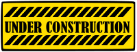

# Planning your podcast
### Where to start...

Planning, or pre-production, is an important part of podcast creation. **The more time you put into preparation, the easier it will be to record and edit your audio**.

## Podcast planning checklist

As you start thinking about your new podcast ideas, you can use this **checklist of considerations** to help refine it into shape.

- [x] **Clarify your concept** 

	What topic is the podcast or audio story about? Being personally connected to your work is helpful in any creative project. So, ask yourself what excites you about your concept and build on that. Maybe you were inspired by another podcast, or an aspect of one you want to explore in more detail. What about that inspirational podcast worked for you and what did not? With so many podcasts currently available, having a niche perspective or specific subject can be an advantage. 

- [x] **Ascertain your audience** 

	Narrowing down your audience will give your podcast project some helpful focus. It will also encourage you to script your work consistently. If your concept is something specific, then your audience will probably be people with the same passion or interest as you. But, within that imagined group, think through who will be your likeliest listeners.

- [x] **Find your format** 

	By "format" we mean the style or structure of the show and how it is presented to an audience. 

	Here are a few common formats to consider: 
	- **Solo**: also known as a monologue, this is one 	person talking about a topic. A solo podcast is easier and faster to setup and you can set your own recording schedule. However, it can be intimidating for beginners to carry a whole show alone.
	- **Co-host**: this is a two-person format. Finding someone with whom you have good chemistry is key to an engaging co-host format. In this format, it can be helpful to have a clear idea about roles. For example, one host could provide facts while the other provides comic relief. Or, maybe you are co-host equals. The co-host format is popular for a reason, as it creates an interesting and compelling dynamic. 
	- **Interview**: this format has a host interviewing someone else. The interviewee is usually an expert or someone with a vested interest in the topic. Interviewing is a skill that you need to hone through practice, and it is nuanced enough to deserve some serious consideration, especially if you think that just being natural at it is enough. See [this Podcast Marketing Academy article](https://podcastmarketingacademy.com/how-to-become-better-podcast-interviewer/) to get a sense of what being a good interviewer can take.  
	- **Roundtable**: in this format, a host and a number of guests talk through a specific topic or topics, either as interviews or as conversations. Note that roundtable podcasts can increase the complexity of the recording and editing process. 

- [x] **Determine your duration**

	Podcast lengths vary significantly but the average is probably **around 20 or 30 minutes**. The length of your podcast should depend on your topic and audience. Err on the side of a shorter podcast to start. 

	According to this [Red 11 Media article](https://www.red11media.com/blog/how-long-does-podcast-production-take), podcast production "typically takes four to seven hours per episode for solo shows and six to ten hours for interview formats," and with post-production (editing) alone taking "one to two hours per 30 minutes of audio." As you practice you will get quicker at editing, but there is a reason why professional podcasts have entire production teams.

- [x] **Figure out your frequency**

	Set a goal of how frequently you will make episodes. It is better to have an excellent podcast every month instead of a mediocre podcast every week. 

- [x] **Settle on a series or single episode** 

	Will your podcast be a single recording or an ongoing series? If it is a series, will every episode use the same format and topics? Or, maybe you want to produce a single episode that could be expanded into a series, later. 

- [x] **Wrangle your recording tech and location**

	Finally, consider where and how you will record your podcast audio. We cover this in the following [Podcasting Tips](podcasting-tips.html) section of this workshop, but in the planning phase, consider your options for a consistently available location and appropriate and reliable equipment. Not every podcast needs to sound polished—in fact, some of the best ones are not—but they should sound consistent.  

## Additional podcast planning resources

Depending on what type of podcast format you choose, you might find some of the following resources more valuable than others.

### Resources for episode outlines 

Assuming that you have worked through the planning checklist, it will be time to create a **podcast outline**. The outline is different from the podcast script, which we look at soon. 

The podcast outline is an organizational tool used to map out each of your episode's topics, questions, and segments, or "acts"—most podcast episodes have three acts. 

Once you have each of your episode(s) in outline form you will be able to see better where you need to make changes, so that your episodes are consistent in terms of pace, content, and duration. 

Here is a list of **resources to get you started on podcast outlines**: 

- [Talks.co: "7 Podcast Outline Templates, Examples, Outros, Scripts + Guide 2027"](https://talks.co/p/podcast-outline-templates/)
- [Lower Street: "The Podcast Outline Guide"](https://lowerstreet.co/how-to/podcast-outline)
- [Podcastools: "Free Podcast Outline Templates & Builder"](https://www.podcastools.com/podcast-outline-builder)

### Resources for podcast interviews

Whatever podcast format you choose, at some point you will be acting as an interviewer of some kind. Even if you are not formally interviewing your guests, there is an art and practice to using the right kinds of questions to put your guests or co-hosts at ease and to get interesting conversations rolling.   

Here is a list of **resources to introduce you to the art of interviewing** and, by extension, the art of guided conversation: 

- [Columbia Journalism Review: "The art of the interview"](https://www.cjr.org/realtalk/the_art_of_the_interview.php)
- [Reporter Union: "How to Conduct a Journalistic Interview: Step-by-Step Guide"](https://reporterunion.com/learn/how-to-conduct-an-interview/)
- [Poynter: How journalists can become better interviewers](https://www.poynter.org/reporting-editing/2013/how-journalists-can-become-better-interviewers/)
- [Columbia Journalism: "Interviewing Principles"](https://columbia.edu/itc/journalism/isaacs/edit/MencherIntv1.html)
- [So Many Questions: "What Makes a Good Podcast Conversation? A Guide to Conversational Podcasting"](https://somanyquestions.show/podcast/conversational-podcasts-guide/)

[NEXT STEP: Scripting Your Podcast](podcasting-scripting.html){: .btn .btn-blue }
