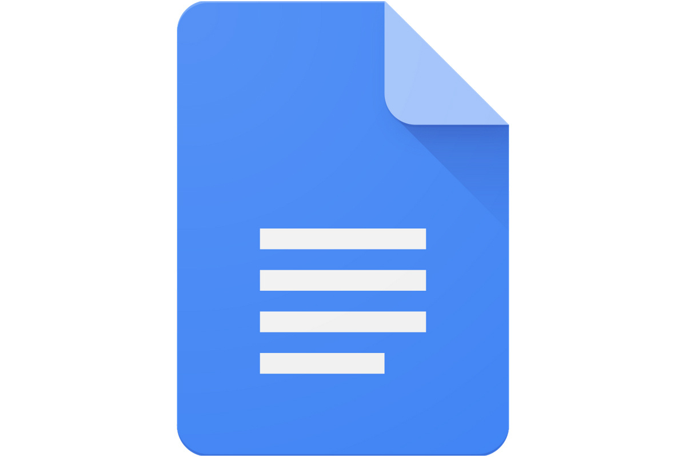

# Scripting your podcast

A podcast script is **a document that defines the structure of your podcast episode's content**. 

Think of the script as your content compass: it will help you keep on track if you start to get lost. 

A good podcast script will provide a good balance of structure and freedom, so that you and your guest(s) never feel too controlled or too lost. 

Here is **an example of what a scripted interview podcast looks like when written down (in script form)**:

## Educational Robotics script example 

**[_Opening music_]** 

**[Introduction]** 

- **[Emily speaking]** Hello, my name is Emily Yang and welcome to the ‘Educational Robotics’ podcast, where we cover all things robotic in K12 education! With me today is Tiffany Johnson, who is an engineer at the Ada Fruit electronics company, and semi-professional Battle Bot maker. We’re going to talk about her latest Battle Bot win robot and how she got started a robot club at her daughter’s middle school. I’m looking forward to an interesting fun interview with Tiffany. 

**[_Sound effect: helicopter_]** 

- **[Emily speaking]** Welcome to the Educational Robotics podcasts Tiffany! 

- **[Tiffany speaking]** I’m happy to be here, and am a big fan of the podcast. 

**[Topic 1]** 

- **[Emily speaking]** We’re so glad you could make time to visit us today. You have a very interesting background in both robotics and education. Let’s start by talking about your big win in last weeks’ nation battle bot championship in Los Angeles. How did you incorporate a flame thrower in your robot, and how big a factor was the flame thrower in your title win? 

- **[Tiffany speaking]** The flame thrower played a huge role in my win, as no one else had used one in the competition before, and I think because of that, no one was prepared to deal with what a flame thrower would do to their battle bot. Incorporating it into my robot wasn’t easy because in large part because I had to make sure that it not only would work against other battle bots but wouldn’t singe the hair of the spectators in the arena. After a bit of fine-tuning, I was able to make sure it wouldn’t burn any spectators but was still able to fry my opponent’s battle bots. 

**[_Sound effect: wind_]** 

**[Topic 2]** 

- **[Emily speaking]** Wow that was an amazing win. When did you first get started in Robotics, and why did you decide that robotics and education would be a good fit? 

- **[Tiffany speaking]** I was in grade 5 at Hillcrest elementary school when Mr. Blackmore brought a Lego Midstorm kit into class and left it out for us to play with if we were interested. My friend Jack and I immediately started tinkering with it, and with a little help from Mr. Blackmore, we were able to build and program a little “car” robot that used a camera sensor to follow a black line on a bit piece of construction paper. It wasn’t very sexy, but it was fun to build and gave us both a sense of accomplishment, and a real desire to build a bigger and more destructive! 

- **[Emily speaking]** That’s a great story, and let’s give a shout out to Mr. Blackmore for the great work he’s doing at Hillcrest Elementary school in Victoria, BC! 

**[_Sound effect: helicopter_]** 

- **[Emily speaking]** Tiffany, thank-you so much for joining us this week on the Education Robotics podcast. Make sure to visit our website at EduRobotics.Net, where you can subscribe to our podcast in iTunes, Stitcher or via RSS so that you’ll never miss a show. While you’re at it, if you liked our show, we’d appreciate a rating on iTunes, or simply tell a friend about the show. We’ll talk to you next week! 

**[_Closing music_]** 

## Choose a script that works for you

Generally, your script should be as detailed as your project demands. 

For example, a casual conversation between friends that all share the same or similar expertise might need a script with only talking-point prompts to keep things on track. 

Or, if you are doing a solo podcast that does deep dive into a complex historical subject, you would likely benefit from a precise script with written dialogue and a clear and easily followed structure. 

Here is a list of **resources on how to create your own podcast scripts**:

- [AudioDramaProduction.com: "Podcast Script – Definition & Detailed Explanation"](https://audiodramaproduction.com/podcast-production-glossary/podcast-script/)
- [Podcast Pontifications: "Podcast Script Examples: Templates for Solo, Interview, and Narrative Shows"](https://podcastpontifications.com/uncategorized/podcast-script-examples/)
- [Descript: "How to Write a Podcast Script: Step-by-Step in 2026"](https://www.descript.com/blog/article/podcast-script)
- [Spotify for Podcasters: "How to Write Podcast Scripts: Tips and Templates to Structure Your Episodes"](https://podcasters.spotify.com/resources/learn/create/how-to-write-podcast-scripts)

## Next steps: produce your podcast! 

Assuming that you have your script in place and you are ready to record, please return, unless you have not been there already, to this workshop's walkthrough of how to record your first podcast: 

**NOTE for UVic students, staff, and faculty:** UVic offers resources for podcasting and audio recording, including bookable media-creation rooms. The Mearns Centre for Learning, in the McPherson Library, has a [dedicated podcast room](https://www.uvic.ca/systems/labs/rooms-drop-ins/media-spaces/index.php#ipn-sound-video-production). UVic students can also use the [podcast corner](https://www.uvic.ca/systems/labs/rooms-drop-ins/find-space/labs/podcast-corner.php) in the Human & Social Development Building. In addition, the McPherson Library and HSD building have dedicated [sound and video rooms](https://www.uvic.ca/systems/labs/rooms-drop-ins/media-spaces/index.php#ipn-sound-video-production). Another option is to [borrow media equipment from the McPherson Library](https://www.uvic.ca/library/rooms-technology/laptops-equipment/index.php#ipn-equipment-details-mearns-mcpherson-library-) by going to the [Ask Us Desk](https://www.uvic.ca/library/visit-and-contact/mearns-mcpherson-library/index.php#ipn-ask-us-desk) on the main floor. 

If you haven't done so already, please download and install Audacity on your laptop. If you missed it, [step 1 of the Pre-Workshop Activities page](https://uviclibraries.github.io/podcasting/pre-workshop.html) has download links for Mac and Windows computers.  

[NEXT STEP: Podcast Recording with Audacity](recording-audio.html){: .btn .btn-blue }
