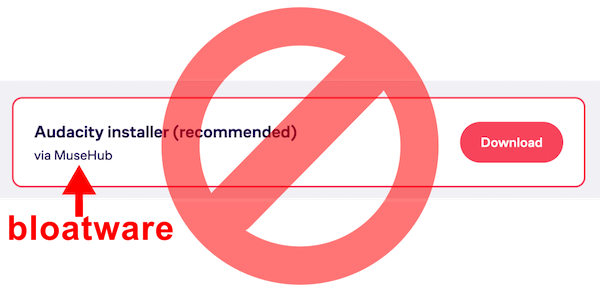

## Pre-Workshop Videos and Activities
This workshop is primarily hands-on practice with Audacity in order to learn to use key features of the software. 

To participate fully, please do the following **before the workshop.**

## 1. Install Audacity on your laptop

<mark>IMPORTANT: we need you to install the correct version of Audacity!<mark> 

**Please follow these install instructions completely before proceeding in the workshop.</mark>** 

### Choose your operating system

Install Audacity on a Mac computer (mac OS)

**For newer Mac computers (~2019 onward), download this [Universal macOS installer](https://github.com/audacity/audacity/releases/download/Audacity-3.7.9/audacity-macOS-3.7.9-universal.dmg).** 

**NOTE: older Intel Macs** (typically before 2019) use this [x86_64 dmg Intel installer](https://github.com/audacity/audacity/releases/download/Audacity-3.7.7/audacity-macOS-3.7.7-x86_64.dmg). 

Install Audacity on a Windows computer (Windows 11)

For a **Windows computer**, use this [64 bit installer](https://github.com/audacity/audacity/releases/download/Audacity-3.7.7/audacity-win-3.7.7-64bit.exe).

If none of the above installers work, especially for an older computer or operating system, then choose from this list of [older Audacity versions](https://www.fosshub.com/Audacity-old.html).  

Install Audacity on a Linux computer

  
Audacity also has a [Linux installer](https://www.audacityteam.org/download/linux/). See this [Installing and updating Audacity on Linux page](https://manual.audacityteam.org/man/installing_and_updating_audacity_on_linux.html) for details as needed.

### Important install tips

If you end up on Audacity's [Downloads page](https://www.audacityteam.org/download/), **we _do not_ recommend using any installers named "Audacity installer (recommended) via MuseHub**," becasue MuseHub is [bloatware](https://en.wikipedia.org/wiki/Software_bloat#Bloatware) that will be installed along with the Audacity installation.

**DO NOT use any installers that include MuseHub.**

## 2. Review the following videos: 
- [Should I Make a Podcast?](https://www.youtube.com/watch?v=zzLdlGDujZc) (4 min)
<iframe width="560" height="315" src="https://www.youtube.com/embed/zzLdlGDujZc" title="YouTube video player" frameborder="0" allow="accelerometer; autoplay; clipboard-write; encrypted-media; gyroscope; picture-in-picture" allowfullscreen></iframe>
- [Planning your Podcast](podcast-planning.html) (5 min) 
- [Sample Podcast Script](sample-podcast-script.html) (2 min)
- OPTIONAL: [Podcasting 101 from PRX & Google Podcasts](https://www.youtube.com/playlist?list=PL7I-Eysv4kq4P9a_942suQdE1_0WiFxFo) is an excellent series of 10 short videos that cover the podcasting creation process from start to finish. They include a video on monetization, which is a topic not covered in this DSC workshop.
- OPTIONAL (for in-person workshop participants): review the [introductory slides](https://docs.google.com/presentation/d/1vRFxxqluG62jjOwkSjjBBoGSZUBUaKfcXDCA5PAWtWM/edit?usp=sharing)

[NEXT STEP: Introduction to Hands-On Activities](activities-intro.html){: .btn .btn-blue }
